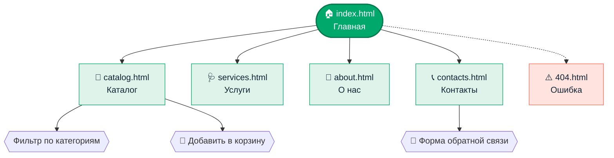
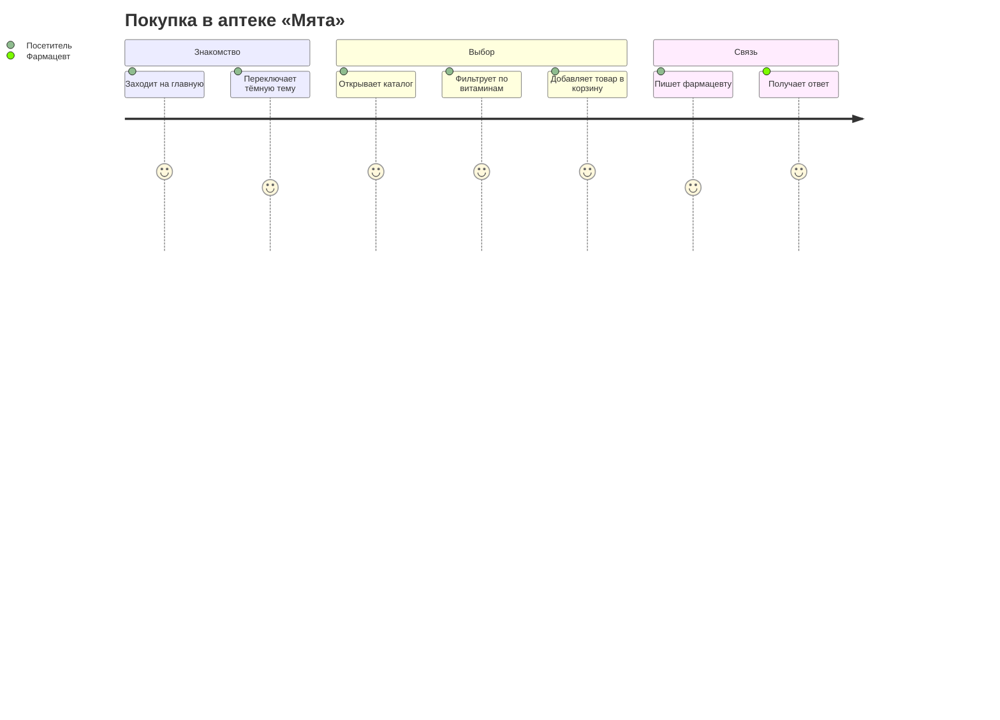
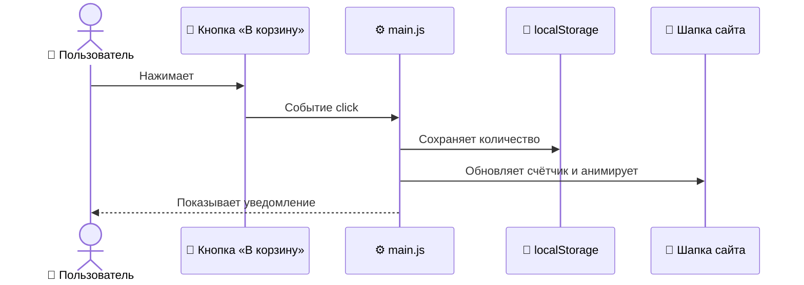
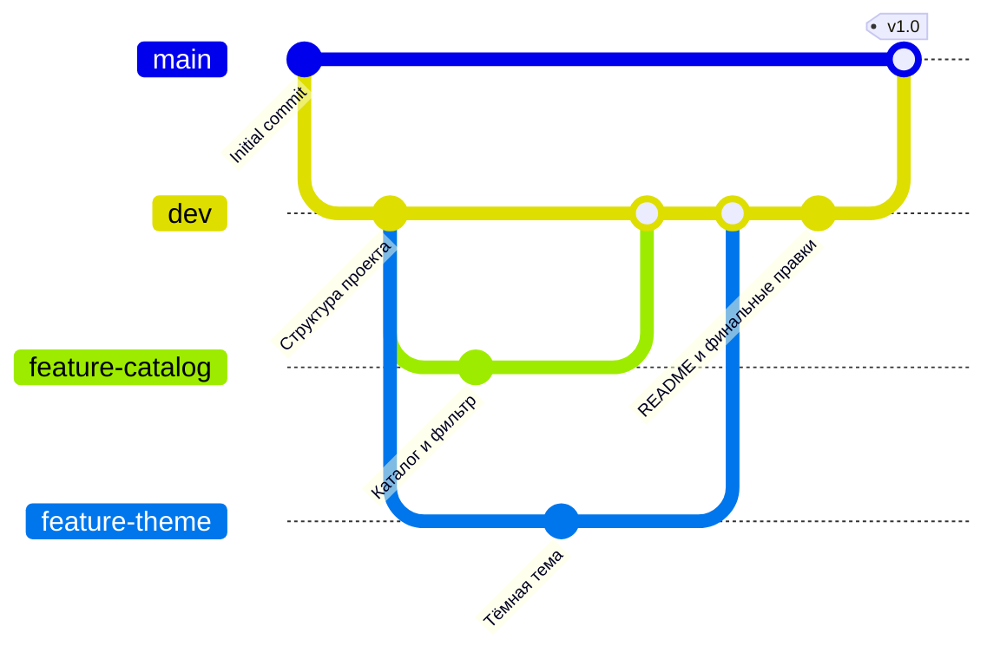

<div align="center">


# 💊 Аптека «Мята»

**Современный сайт-визитка аптеки: быстро, адаптивно, с темной темой и анимациями**

[](https://ВАШ_ЛОГИН.github.io/apteka/)
[](https://pages.github.com/)


[Демо](#-демо) · [Возможности](#-возможности) · [Структура](#-структура-проекта) · [Запуск](#-быстрый-старт) · [Команда](#-команда)

</div>

---

## 🌿 О проекте

**«Мята»** — учебный командный проект: статический многостраничный сайт вымышленной аптеки.
Мы показываем, как несколько разработчиков могут вместе работать над одним репозиторием с помощью **Git** и **GitHub**, и при этом получить аккуратный, современный и удобный сайт.

> 💡 Сайт не требует сборки и серверной части: чистые **HTML + CSS + JS**, публикация через **GitHub Pages**.

## 🖼 Демо

> 📸 Добавьте сюда скриншоты в папку `docs/` и подключите их так:

| ☀️ Светлая тема | 🌙 Тёмная тема | 📱 Мобильная версия |
|:---:|:---:|:---:|
| `docs/light.png` | `docs/dark.png` | `docs/mobile.png` |

🔗 **Сайт:** https://ВАШ_ЛОГИН.github.io/apteka/

## ✨ Возможности

| | Функция | Описание |
|---|---|---|
| 🌗 | **Переключатель темы** | Светлая и тёмная тема, выбор запоминается, учитывает настройки системы |
| 💊 | **Анимированный блистер** | Капсулы «падают» на главной странице и плавно покачиваются |
| 🎞 | **Бегущая строка** | Категории товаров, пауза при наведении |
| 🔢 | **Счётчики** | Цифры плавно набираются при прокрутке |
| 🛒 | **Мини-корзина** | Счётчик в шапке, уведомления, сохранение между страницами |
| 🔎 | **Фильтр каталога** | Мгновенная фильтрация товаров по категориям |
| 📝 | **Форма обратной связи** | Валидация полей и всплывающее уведомление |
| 📱 | **Адаптивность** | Корректно выглядит на телефоне, планшете и компьютере |
| ♿ | **Доступность** | Видимый фокус, поддержка «уменьшения движения» |

## 🗺 Карта сайта



## 🧭 Путь посетителя



## ⚙️ Как работает корзина



## 🌳 Ветки проекта



| Ветка | Назначение |
|---|---|
| `main` | Стабильная версия, из неё публикуется сайт |
| `dev` | Основная разработка |
| `feature-*` | Новые функции (по желанию) |
| `hotfix-*` | Срочные исправления (по желанию) |

## 📁 Структура проекта

```text
apteka/
├── 📄 index.html          # Главная
├── 📄 catalog.html        # Каталог товаров
├── 📄 services.html       # Услуги
├── 📄 about.html          # О нас
├── 📄 contacts.html       # Контакты и форма
├── 📄 404.html            # Страница ошибки
│
├── 📁 css/
│   └── 📄 style.css       # Стили, темы, адаптив
├── 📁 js/
│   └── 📄 main.js         # Тема, корзина, фильтр, форма, анимации
├── 📁 images/
│   ├── 🖼 logo.svg
│   ├── 🖼 hero.svg
│   └── 🖼 about.svg
│
├── 📄 README.md
└── 📄 .gitignore
```

## 🚀 Быстрый старт

```bash
# 1. Клонировать репозиторий
git clone https://github.com/ВАШ_ЛОГИН/apteka.git
cd apteka

# 2. Перейти в ветку разработки
git checkout dev

# 3. Открыть сайт
#    двойной клик по index.html
#    или расширение Live Server в VS Code
```

### 🌐 Публикация на GitHub Pages

1. Откройте **Settings → Pages**
2. В **Source** выберите **Deploy from a branch**
3. Ветка `main`, папка `/ (root)` → **Save**
4. Через 1–2 минуты сайт будет доступен по адресу из раздела «Демо»

## 🎨 Дизайн

| Роль | Цвет | HEX |
|---|---|---|
| Основной | 🟩 Мятный зелёный | `#00a86b` |
| Акцент | 🟥 Коралловый | `#ff6b5b` |
| Светлый фон | ⬜ Холодный белый | `#f2f7f9` |
| Тёмный фон | ⬛ Глубокий синий | `#0b1620` |

**Шрифты:** [Unbounded](https://fonts.google.com/specimen/Unbounded) для заголовков и [Onest](https://fonts.google.com/specimen/Onest) для текста.

## 👥 Команда

| Роль | Участник | Зона ответственности |
|---|---|---|
| 👑 Тимлид | [@логин](https://github.com/логин) | Репозиторий, координация, ревью |
| 💻 Разработчик 1 | [@логин](https://github.com/логин) | Главная, каталог |
| 💻 Разработчик 2 | [@логин](https://github.com/логин) | Услуги, о нас |
| 💻 Разработчик 3 | [@логин](https://github.com/логин) | Контакты, стили, JS |

## 🤝 Как участвовать

```bash
git pull                              # обновиться перед работой
git checkout -b feature-моя-задача    # создать ветку
git add .
git commit -m "Добавил ..."           # понятное сообщение
git push -u origin feature-моя-задача # отправить и открыть Pull Request
```

## ⚠️ Дисклеймер

Аптека, адрес, телефон и цены вымышленные. Проект создан в учебных целях и не заменяет консультацию врача.

---

<div align="center">

Сделано с 💚 командой «Мята»

⭐ Поставьте звезду, если проект понравился

</div>
